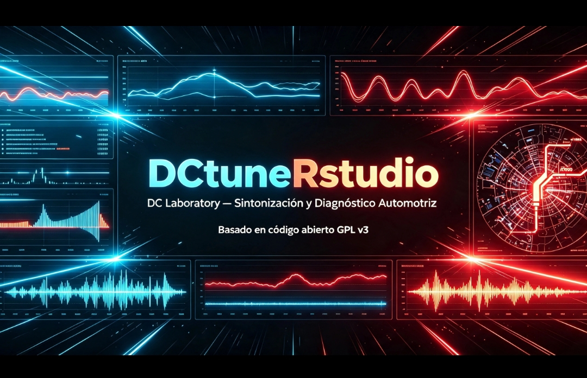
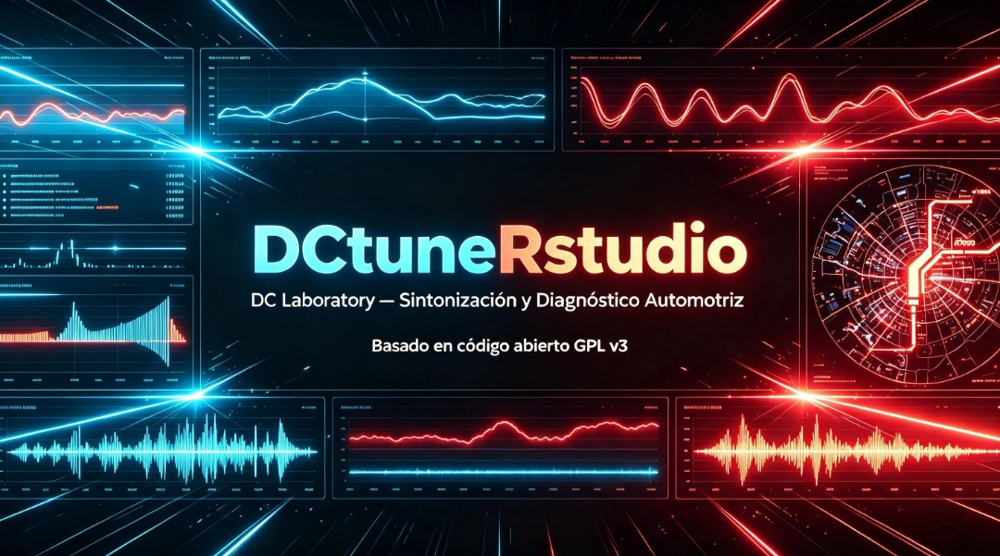
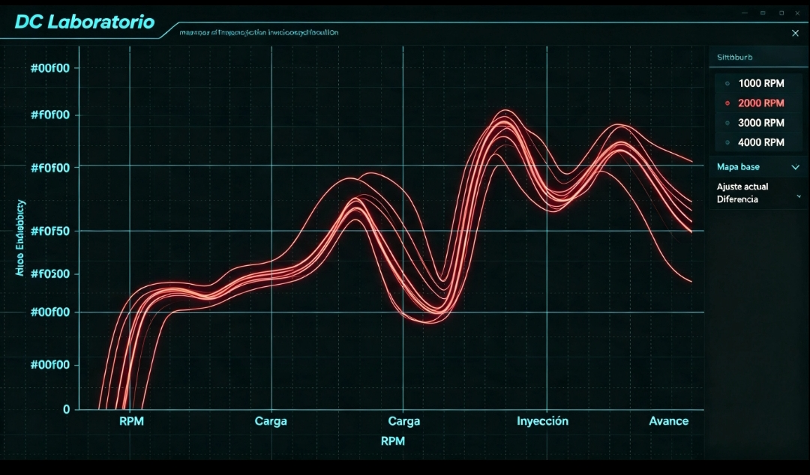
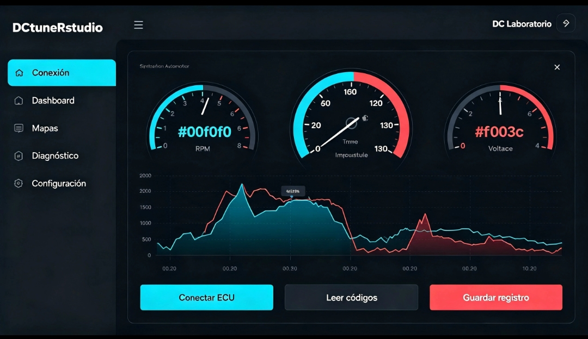
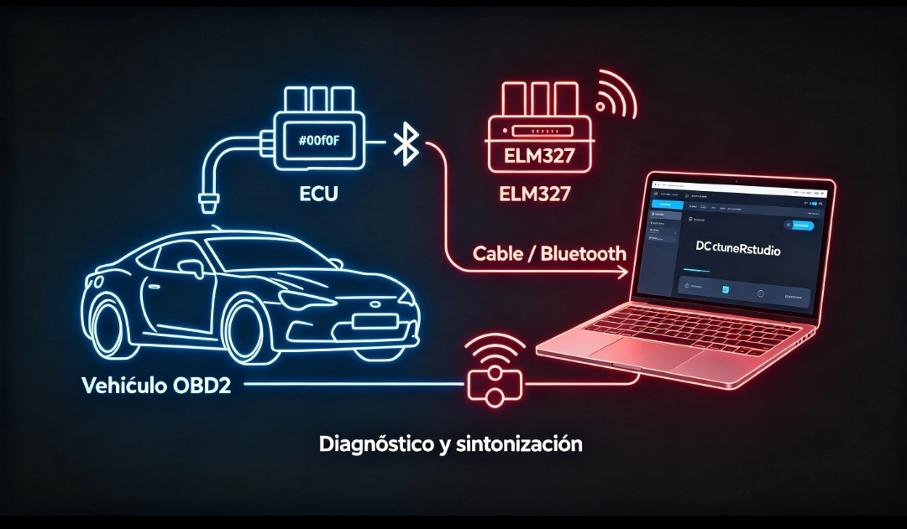

# DCtuneRstudio
## Diagnóstico y Sintonización Automotriz — Versión PC

**DC Laboratory** — Código abierto para sintonización y monitoreo de ECU desde computadora.

---

## 📊 Pantallas

### Panel Principal

### Gráficas en Tiempo Real

### Mapas y Calibración

---

## 🔌 Conexión

ECU → Adaptador ELM327 → Laptop/PC

---

© 2026 DC Laboratory
